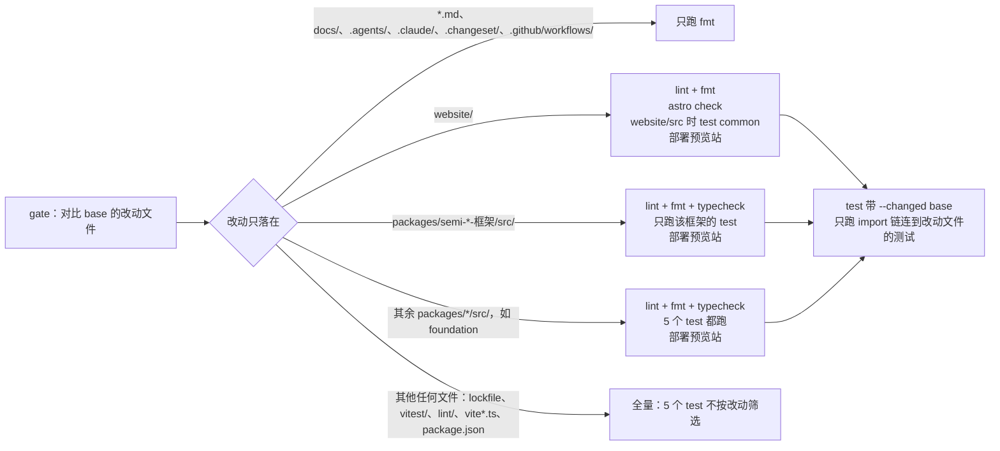

# 参与贡献

感谢你愿意改进 Semi Design Next。提交 issue 或 PR 前，请先读完本文。

## 提问与反馈

- 缺陷：使用 [Bug 报告](https://github.com/smile-alive/semi-design-next/issues/new?template=bug-report.yml) 模板，附上可复现的最小示例、框架与浏览器版本。
- 新功能：先开 [功能建议](https://github.com/smile-alive/semi-design-next/issues/new?template=feature-request.yml) 讨论，确认方向后再写代码。
- 安全问题：不要公开提 issue，按 [SECURITY.md](SECURITY.md) 私下报告。

本项目是 [Semi Design](https://github.com/DouyinFE/semi-design) 的社区 fork，不合并回上游。上游的问题请到上游仓库反馈。

## 开发环境

Node 26.10.0 与 pnpm 12.9.1 由 [mise](https://mise.jdx.dev) 按 `mise.toml` 安装：

```bash
mise install
pnpm install
pnpm build
pnpm site:dev
```

写法规则在 [AGENTS.md](AGENTS.md) 与 `.agents/references/`，人和编码 agent 共用同一套规则；改哪个框架的包，先读该框架目录下的全部规则。

## 支持环境

- 各框架包的版本范围以其 `package.json` 的 `peerDependencies` 为准
- 浏览器、模块格式、Node.js 与构建插件的版本要求见[快速开始的环境要求](website/content/start/getting-started/index.zh-CN.mdx#环境要求)
- React、Vue、Solid、Svelte 支持服务端渲染与 hydration，React 另支持 RSC 客户端边界；宿主配置见各插件 README

## 目录结构

| 路径 | 说明 |
| --- | --- |
| [`packages/semi-ui-react`](packages/semi-ui-react/README.zh-CN.md) | React 组件库 `@fibrae/semi-ui-react` |
| [`packages/semi-ui-vue`](packages/semi-ui-vue/README.zh-CN.md) | Vue 组件库 `@fibrae/semi-ui-vue` |
| [`packages/semi-ui-solid`](packages/semi-ui-solid/README.zh-CN.md) | Solid 组件库 `@fibrae/semi-ui-solid` |
| [`packages/semi-ui-svelte`](packages/semi-ui-svelte/README.zh-CN.md) | Svelte 组件库 `@fibrae/semi-ui-svelte`，发布 `.svelte` 源码 |
| [`packages/semi-foundation`](packages/semi-foundation/README.zh-CN.md) | 与框架无关的组件逻辑和 SCSS；唯一的主题（全局 token、色板、mixin）在 `src/theme/` |
| [`packages/semi-ai-react`](packages/semi-ai-react/README.zh-CN.md) | AI 组件 `@fibrae/semi-ai-react`（AIChatInput、AIChatDialogue、Chat、Sidebar），基于 semi-ui-react |
| [`packages/semi-ai-vue`](packages/semi-ai-vue/README.zh-CN.md) | Vue 版 AI 组件 `@fibrae/semi-ai-vue`（AIChatInput、AIChatDialogue、Chat、Sidebar），基于 semi-ui-vue |
| [`packages/semi-ai-solid`](packages/semi-ai-solid/README.zh-CN.md) | Solid 版 AI 组件 `@fibrae/semi-ai-solid`，基于 semi-ui-solid |
| [`packages/semi-ai-svelte`](packages/semi-ai-svelte/README.zh-CN.md) | Svelte 版 AI 组件 `@fibrae/semi-ai-svelte`，基于 semi-ui-svelte，发布 `.svelte` 源码 |
| [`packages/semi-ai-foundation`](packages/semi-ai-foundation/README.zh-CN.md) | AI 组件与框架无关的逻辑、SCSS 和编辑器插件，基于 semi-foundation |
| [`packages/semi-icons-core`](packages/semi-icons-core/README.zh-CN.md) | 图标的唯一源 `svgs/icons`（保留原色的彩色图标在 `svgs/lab`，插画在 `svgs/illustrations`）与由它生成的框架无关图标与插画数据 `@fibrae/semi-icons-core` |
| [`packages/semi-icons-react`](packages/semi-icons-react/README.zh-CN.md) | React 图标组件 `@fibrae/semi-icons-react`，每个图标由 core 的数据经 `createIcon` 生成；彩色图标在子路径 `@fibrae/semi-icons-react/lab` |
| [`packages/semi-icons-vue`](packages/semi-icons-vue/README.zh-CN.md) | Vue 图标组件 `@fibrae/semi-icons-vue`，与 React 共享 core 数据与样式；彩色图标在子路径 `/lab` |
| [`packages/semi-icons-solid`](packages/semi-icons-solid/README.zh-CN.md) | Solid 图标组件 `@fibrae/semi-icons-solid`，读同一份 core 数据 |
| [`packages/semi-icons-svelte`](packages/semi-icons-svelte/README.zh-CN.md) | Svelte 图标组件 `@fibrae/semi-icons-svelte`，读同一份 core 数据 |
| [`packages/semi-animation`](packages/semi-animation/README.zh-CN.md) | 给 Motion 用的 Semi 预设（缓动、弹簧）与 View Transition 预设类 `@fibrae/semi-animation` |
| [`packages/semi-polyfill`](packages/semi-polyfill/README.zh-CN.md) | 可选 polyfill `@fibrae/semi-polyfill`（`AbortSignal.any`、`Element.prototype.checkVisibility`），供 Safari 17.2 与 17.3 在入口最先导入 |
| [`packages/semi-illustrations-react`](packages/semi-illustrations-react/README.zh-CN.md) | React 插画组件，由 `semi-icons-core` 的插画数据生成，实例隔离渐变、滤镜与 mask ID |
| [`packages/semi-illustrations-vue`](packages/semi-illustrations-vue/README.zh-CN.md) | Vue 插画组件，由 `semi-icons-core` 的插画数据生成，实例隔离渐变、滤镜与 mask ID |
| [`packages/semi-illustrations-solid`](packages/semi-illustrations-solid/README.zh-CN.md) | Solid 插画组件，由同一份插画数据生成 |
| [`packages/semi-illustrations-svelte`](packages/semi-illustrations-svelte/README.zh-CN.md) | Svelte 插画组件，由同一份插画数据生成 |
| [`packages/semi-json-viewer-core`](packages/semi-json-viewer-core/README.zh-CN.md) | JsonViewer 的编辑器内核 |
| [`packages/semi-scss-compile`](packages/semi-scss-compile/README.zh-CN.md) | 把 Semi SCSS 编译为 CSS 的工具 |
| [`packages/semi-theme-shared`](packages/semi-theme-shared/README.zh-CN.md) | 插件与 `semi-scss-compile` 共用的 `semi:` Sass importer 与编译管线，不发布 |
| [`packages/semi-vite`](packages/semi-vite/README.zh-CN.md)、[`semi-webpack`](packages/semi-webpack/README.zh-CN.md)、[`semi-rspack`](packages/semi-rspack/README.zh-CN.md)、[`semi-next`](packages/semi-next/README.zh-CN.md) | 类名前缀替换、`@layer semi` 开关与 `omitCss` 的构建插件 |
| [`packages/semi-nuxt`](packages/semi-nuxt/README.zh-CN.md) | Nuxt 4 模块 `@fibrae/semi-nuxt`，把 semi-vite 插件注册进 Nuxt 的 Vite 构建，并在应用未设置时关闭 `features.inlineStyles` |
| `scripts/svg-to-icon-data.ts` | 图标与插画共用的 SVG 转数据脚本，各框架的图标与插画组件都由这份数据生成 |
| `vitest/` | 测试项目注册与 setup（`vitest/<框架>/` 放该框架的 setup、tsconfig 与工具）、测试工具（`@test/utils/<框架>` 与框架无关的模块）与打包产物测试 `vitest/packed` |
| `.agents/references/<框架>/` | 各框架的组件、测试、lint 与 website 写法，框架无关的写法见 `.agents/references/` 下的共享文件 |
| [`website/`](website/README.zh-CN.md) | Astro 文档站，正文在 `website/content/<分类>/<页面>/index.<语言>.mdx` |

各包的源码在 `src/`，`vp pack` 的产物在 `dist/`，含逐文件的 ESM、类型声明和组件 CSS，UI 包另有整包样式 `styles.css` 与 `tailwind.css`；发布的子路径与 `src/` 下的目录一一对应。

## 样式定制

仓库只有一份主题，位于 `packages/semi-foundation/src/theme/`，组件 SCSS 经 `semi:theme` 加载它；没有主题包，也没有编译期的 Sass 变量覆写。使用方只通过 `--semi-*` CSS 变量（全局 token，Tailwind 映射见 `@fibrae/semi-ui-react/tailwind.css`）和 `@layer semi` 之外的 CSS 规则定制样式。Sass 变量是内部实现。

## 常用命令

```sh
mise install                 # 安装 Node 与 pnpm
pnpm install                 # 安装依赖

pnpm site:dev                # 后台启动文档站 dev server（http://127.0.0.1:4321）
pnpm site:build              # 文档站生产构建，产物在 website/dist
pnpm site:preview            # 后台预览生产构建（http://127.0.0.1:4322），需先 site:build
pnpm site:serve              # 生产构建后直接后台预览，等于 site:build 加 site:preview
pnpm site:stop               # 停止后台的 dev server 与 preview

pnpm test                    # 单元测试（jsdom）
pnpm test:browser            # 浏览器测试（Playwright Chromium）
pnpm test:coverage           # 先单元后浏览器测试，合并覆盖率低于 vitest/ 中登记的阈值即失败；不含 SSR 与 hydration 项目
pnpm test:ssr                # SSR 与 hydration 项目（*-ssr、*-hydration-browser），不统计覆盖率

pnpm lint                    # 文件的框架归属、oxlint、stylelint、私有成员、类成员与组件内语句顺序、SCSS 变量、MDX 表格列数与各框架的专属检查，warning 也算失败
vp run --cache lint          # 反复重跑 lint 时用：每一步按读取的文件缓存，没变的步骤直接回放结果；lint:style 每次都执行（stylelint 加载 TS 配置时会写临时文件）
pnpm lint:scopes             # 按命名列出各区域属于各框架与通用范围的文件数；带文件参数时逐个列出归属
pnpm lint:react              # 用 React Compiler 编译 semi-ui-react 全部组件与 hook，列出被放弃的函数
pnpm lint:fix                # 自动修复 lint 问题
pnpm format                  # oxfmt 格式化
pnpm format:check            # 检查格式
pnpm typecheck               # 逐个检查 tsconfig.node.json、各包、website 与 vitest 的配置（Vue 配置用 vue-tsc，其余用 tsc）并运行 `astro check`，输出每个配置的结果与耗时；semi-ui-react 读取 semi-foundation 已构建的类型，需先 build

pnpm build                   # 构建所有包到各自的 dist/，UI 包同时产出整包样式 styles.css 与 tailwind.css
pnpm build:icon              # 由 SVG 重新生成 core 数据及各框架的图标和插画组件
pnpm test:packed             # 在临时 Vite + React 19 应用中安装并构建打包产物，需先运行 build
pnpm test:plugins            # 各插件包的冒烟测试，需先运行 build

pnpm check:changed           # 日常：只检查相对 release 改动的文件，测试只跑受改动影响的用例，不含浏览器测试
pnpm check                   # 提交前：全量 lint、格式、单元与 SSR 测试，不含浏览器测试
pnpm check:full              # 完整校验：构建、类型检查、lint、格式、带覆盖率的测试（含浏览器）、SSR 与 hydration 测试、打包产物与插件测试
```

文档站页面检查（加载错误、空 demo、a11y 基线）：

```sh
pnpm site:build
pnpm site:dev
pnpm --filter semi-website check:pages http://127.0.0.1:4321
pnpm site:stop
```

`check:pages` 可追加路径过滤参数，例如 `/show/table`；全量运行时加 `--update-a11y-baseline` 会重写 `website/scripts/a11y-baseline.json`。

## 文档

| 文件                                                         | 内容                                                          |
| ------------------------------------------------------------ | ------------------------------------------------------------- |
| [docs/decisions.md](docs/decisions.md)                       | 已定决策与未完成事项                                          |
| [docs/release-notes.md](docs/release-notes.md)               | 相对原 Semi 的破坏性变化与行为变化                            |
| [docs/component-issues.md](docs/component-issues.md)         | 未结问题、已知限制与保持原样的决定                            |
| [.agents/references/styles.md](.agents/references/styles.md) | 组件 SCSS 写法、Sass 模块与 `semi:` importer、主题 token 协议 |

## 提交 PR

1. 从 `release` 新建分支，一个 PR 只做一件事。
2. 组件逻辑放 `packages/semi-foundation`，React、Vue、Solid、Svelte 四个框架的包同步修改。
3. 测试断言可见行为；修 bug 不新增回归用例。
4. 行为或公开 API 有变化时：
    - 更新 `docs/release-notes.md` 对应组件的章节；
    - 文档页和 README 的中英文同步修改；
    - 运行 `pnpm changeset` 添加变更说明。
5. 提交前运行：

    ```bash
    pnpm check
    ```

    改动布局、焦点或指针行为时，再跑该组件的浏览器测试：

    ```bash
    vp test run --project react-browser packages/semi-ui-react/src/components/<组件>
    ```

CI 的 `gate` job 先看改了哪些文件，再决定跑什么。多类改动取并集；跳过的 job 以 skipped 计入必需检查。



Chromium、Firefox、WebKit 三个浏览器的完整测试每天定时运行，只在上次通过的 commit 之后有 `packages/` 改动时才真正执行。

## 提交

- [Conventional Commits](https://www.conventionalcommits.org/)，`type(scope)` 用英文，scope 写包名或组件目录名，标题与正文用中文；标题不超过 72 个字符，正文每段一行，由 commitlint 检查。
- pre-commit 对暂存文件运行 `vp lint --fix`、`vp fmt`、stylelint，`.vue` 与 `.svelte` 另跑 ESLint，warning 也会阻止提交；规则见 `vite.config.ts` 的 `staged`。
- 钩子由 `pnpm install` 的 `prepare`（`vp config`）安装，`core.hooksPath` 设为相对路径 `.vite-hooks/_`。`vp config` 不覆盖已有的其他 `core.hooksPath`，提交时钩子没有执行就先 `git config --unset core.hooksPath`，再跑 `pnpm install`。

## 分支

历史是一条直线：仓库只允许「Rebase and merge」，`main` 和 `release` 的规则集都要求线性历史，不接受 merge commit。

| 分支      | 作用                                                                                                                                                                   |
| --------- | ---------------------------------------------------------------------------------------------------------------------------------------------------------------------- |
| `release` | 默认分支，唯一的集成分支。所有改动从它拉分支，经 PR rebase 合入；推送后跑 CI，通过后部署预览站 `release.semi-design-next.pages.dev`，再由 Release 工作流处理版本与发布 |
| `main`    | 指向最后一次发版的 commit，永远是 `release` 的祖先。只由 Release 工作流在发布成功后 fast-forward 推送；它不接收 PR                                                     |

## 发布

所有 `@fibrae/*` 包发布到 npm 公共 registry，共用一个版本号，由 [changesets](.changeset/README.md) 管理。

1. 改动发布包的行为或公开 API 时，在功能 PR 里运行 `pnpm changeset` 添加变更说明；没有 changeset 的改动不会发版。
2. `release` 上有 changeset 时，Release 工作流在每次 CI 通过后开出或更新「chore: 发布新版本」PR（分支 `changeset-release/release`），汇总版本号与各包 CHANGELOG。这个 PR 由 github-actions[bot] 开出，它的 CI 停在等待批准：在 PR 底部点「Approve workflows to run」。
3. 要发版时，把版本 PR rebase 合入 `release`。它的 CI 通过后，Release 工作流用 npm Trusted Publishing（OIDC，不用 `NPM_TOKEN`）发布并附带 provenance，为每个包推送 `<包名>@<版本>` tag 并创建 GitHub Release，然后把 `main` fast-forward 到这个 commit 并部署正式站。新增的发布包要先在 npm 上存在并为 `release.yml` 配置 Trusted Publisher，才能由工作流发布。
4. 版本 PR 合入到发布完成之间几分钟内合入的功能 PR 会一起发出去；要精确控制发版内容，等 Release 工作流结束再合。

正式文档站只在发版时更新。发版之间要上线文档改动，手动 fast-forward `main`（这个 commit 在 `release` 上已通过 CI，满足 `main` 的必需检查）：

```bash
git push private release:main
```

`main` 收到推送会部署正式站。也可以在 Actions 页手动运行 Deploy site，「Use workflow from」选 `main` 部署正式站，选 `release` 部署预览站。

## 许可

提交贡献即表示你同意以 [MIT 许可](LICENSE) 发布你的代码。
