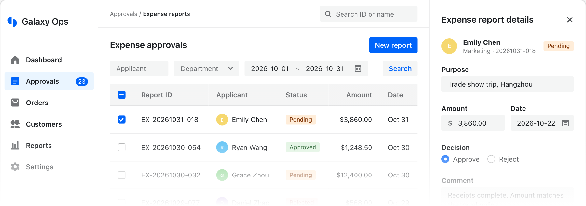

<p align="center">
    <a href="https://semi-design-next.pages.dev">
        <picture>
            <source media="(prefers-color-scheme: dark)" srcset=".github/assets/logo-dark.svg" />
            
        </picture>
    </a>
</p>

<h1 align="center">Semi Design Next</h1>

<p align="center">Accessible components for React, Vue, Solid and Svelte, from one shared core.</p>

<p align="center">
    <a href="https://www.npmjs.com/package/@fibrae/semi-ui-react"></a>
    <a href="https://github.com/smile-alive/semi-design-next/actions/workflows/ci.yml?query=branch%3Arelease"></a>
    <a href="LICENSE"></a>
</p>

<p align="center">
    <a href="https://semi-design-next.pages.dev">Documentation</a>
    ·
    <a href="README.zh-CN.md">简体中文</a>
</p>

<picture>
    <source media="(prefers-color-scheme: dark)" srcset=".github/assets/preview-dark.png" />
    
</picture>

> Semi Design Next is an unofficial community fork of [Semi Design](https://github.com/DouyinFE/semi-design). It is not affiliated with or endorsed by ByteDance, DouyinFE or the Semi Design team. The name "Semi Design" belongs to its rights holders.

## Features

- **Native in four frameworks.** Component logic lives in a framework-agnostic core, and each framework connects to it in its own idiom.
- **Accessible.** Roles, keyboard behavior and accessible names follow WAI-ARIA and the APG.
- **Server rendering.** All four frameworks support SSR and hydration. React also supports the RSC client boundary.
- **ESM and on-demand styles.** Packages ship as ESM only, and each component loads just the CSS it needs.
- **AI components.** Chat input, dialogue and sidebar components come as separate packages.
- **Themeable with CSS.** Customize with `--semi-*` CSS variables and your own CSS rules, with no Sass build step.

## Quick start

Styles load with the components, and no reset stylesheet is needed. Check the [requirements](https://semi-design-next.pages.dev/en-US/react/start/getting-started/#requirements) for supported browsers and tools.

<details open>
<summary><strong>React</strong></summary>

```bash
pnpm add @fibrae/semi-ui-react @fibrae/semi-icons-react
```

```tsx
import { Button, Toast } from '@fibrae/semi-ui-react';

export function App() {
    return <Button onClick={() => Toast.warning({ content: 'welcome' })}>Hello Semi</Button>;
}
```

</details>

<details>
<summary><strong>Vue</strong></summary>

```bash
pnpm add @fibrae/semi-ui-vue @fibrae/semi-icons-vue
```

```vue
<script setup lang="ts">
    import { Button, Toast } from '@fibrae/semi-ui-vue';
</script>

<template>
    <Button @click="Toast.warning({ content: 'welcome' })">Hello Semi</Button>
</template>
```

</details>

<details>
<summary><strong>Solid</strong></summary>

```bash
pnpm add @fibrae/semi-ui-solid @fibrae/semi-icons-solid
```

```tsx
import { Button, Toast } from '@fibrae/semi-ui-solid';

export function App() {
    return <Button onClick={() => Toast.warning({ content: 'welcome' })}>Hello Semi</Button>;
}
```

</details>

<details>
<summary><strong>Svelte</strong></summary>

```bash
pnpm add svelte @fibrae/semi-ui-svelte @fibrae/semi-icons-svelte
```

```svelte
<script lang="ts">
    import { Button, Toast } from '@fibrae/semi-ui-svelte';
</script>

<Button onclick={() => Toast.warning({ content: 'welcome' })}>Hello Semi</Button>
```

</details>

The full guide covers build plugins, server rendering and theming: [React](https://semi-design-next.pages.dev/en-US/react/start/getting-started/), [Vue](https://semi-design-next.pages.dev/en-US/vue/start/getting-started/), [Solid](https://semi-design-next.pages.dev/en-US/solid/start/getting-started/), [Svelte](https://semi-design-next.pages.dev/en-US/svelte/start/getting-started/).

## Packages

Replace `<framework>` with `react`, `vue`, `solid` or `svelte`.

| Package                                                                                                                                                                       | Purpose                                                         |
| ----------------------------------------------------------------------------------------------------------------------------------------------------------------------------- | --------------------------------------------------------------- |
| `@fibrae/semi-ui-<framework>`                                                                                                                                                 | Components                                                      |
| `@fibrae/semi-ai-<framework>`                                                                                                                                                 | AI components                                                   |
| `@fibrae/semi-icons-<framework>`                                                                                                                                              | Icons                                                           |
| `@fibrae/semi-illustrations-<framework>`                                                                                                                                      | Illustrations                                                   |
| [`@fibrae/semi-animation`](packages/shared/animation/README.md)                                                                                                               | Presets for Motion and View Transitions                         |
| [`@fibrae/semi-polyfill`](packages/shared/polyfill/README.md)                                                                                                                 | Optional polyfills for older supported Safari versions          |
| [`@fibrae/semi-vite-plugin`](packages/plugins/vite/README.md), [`-webpack-plugin`](packages/plugins/webpack/README.md), [`-rspack-plugin`](packages/plugins/rspack/README.md) | Build plugins for the class prefix, `@layer semi` and `omitCss` |
| [`@fibrae/semi-next`](packages/plugins/next/README.md), [`@fibrae/semi-nuxt`](packages/plugins/nuxt/README.md)                                                                | Next.js and Nuxt integrations                                   |
| [`@fibrae/semi-scss-compile`](packages/shared/scss-compile/README.md)                                                                                                         | Compiles Semi SCSS to CSS                                       |

## Coming from Semi Design

This fork evolves independently and keeps no backward compatibility with upstream. It keeps the `semi-` class prefix and the `--semi-*` CSS variables, under the `@fibrae/semi-*` package scope. [Release notes](docs/release-notes.md) list the breaking and behavior changes.

## Contributing

Read the [contributing guide](CONTRIBUTING.md) for the repository layout, commands and pull request process. Report security issues as described in [SECURITY.md](SECURITY.md).

## License

[MIT](LICENSE). Third-party notices are in [THIRD-PARTY-NOTICES](THIRD-PARTY-NOTICES).
