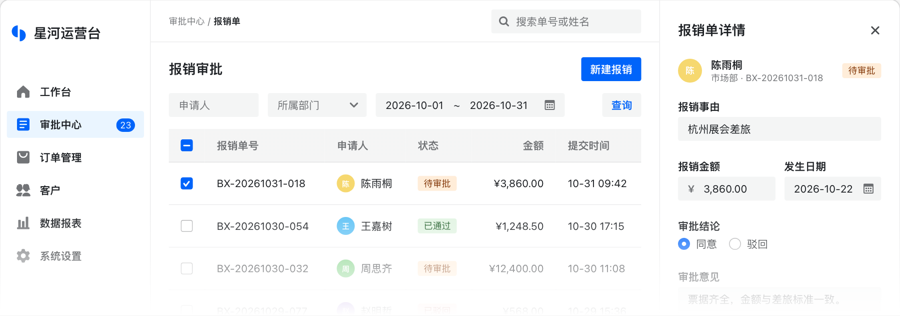

<p align="center">
    <a href="https://semi-design-next.pages.dev">
        <picture>
            <source media="(prefers-color-scheme: dark)" srcset=".github/assets/logo-dark.svg" />
            
        </picture>
    </a>
</p>

<h1 align="center">Semi Design Next</h1>

<p align="center">同一份核心逻辑，原生支持 React、Vue、Solid、Svelte 的无障碍组件库。</p>

<p align="center">
    <a href="https://www.npmjs.com/package/@fibrae/semi-ui-react"></a>
    <a href="https://github.com/smile-alive/semi-design-next/actions/workflows/ci.yml?query=branch%3Arelease"></a>
    <a href="LICENSE"></a>
</p>

<p align="center">
    <a href="https://semi-design-next.pages.dev/zh-CN/">文档</a>
    ·
    <a href="README.md">English</a>
</p>

<picture>
    <source media="(prefers-color-scheme: dark)" srcset=".github/assets/preview-zh-CN-dark.png" />
    
</picture>

> Semi Design Next 是 [Semi Design](https://github.com/DouyinFE/semi-design) 的非官方社区 fork，与字节跳动、DouyinFE 及 Semi Design 官方团队没有关联，也未获得其认可。「Semi Design」名称归其权利人所有。

## 特性

- **四个框架原生接入**：组件逻辑放在与框架无关的核心里，各框架用自己的写法接入。
- **无障碍**：角色、键盘操作和可访问名称遵循 WAI-ARIA 与 APG。
- **服务端渲染**：四个框架都支持 SSR 与 hydration，React 另支持 RSC 客户端边界。
- **ESM 与按需样式**：只发布 ESM，每个组件只加载自己需要的 CSS。
- **AI 组件**：聊天输入、对话和侧边栏组件以独立的包提供。
- **用 CSS 定制主题**：通过 `--semi-*` CSS 变量和自己的 CSS 规则定制，不需要 Sass 构建。

## 快速开始

样式随组件加载，不需要 reset 样式表。支持的浏览器和工具见[环境要求](https://semi-design-next.pages.dev/zh-CN/react/start/getting-started/#环境要求)。

<details open>
<summary><strong>React</strong></summary>

```bash
pnpm add @fibrae/semi-ui-react @fibrae/semi-icons-react
```

```tsx
import { Button, Toast } from '@fibrae/semi-ui-react';

export function App() {
    return <Button onClick={() => Toast.warning({ content: 'welcome' })}>Hello Semi</Button>;
}
```

</details>

<details>
<summary><strong>Vue</strong></summary>

```bash
pnpm add @fibrae/semi-ui-vue @fibrae/semi-icons-vue
```

```vue
<script setup lang="ts">
    import { Button, Toast } from '@fibrae/semi-ui-vue';
</script>

<template>
    <Button @click="Toast.warning({ content: 'welcome' })">Hello Semi</Button>
</template>
```

</details>

<details>
<summary><strong>Solid</strong></summary>

```bash
pnpm add @fibrae/semi-ui-solid @fibrae/semi-icons-solid
```

```tsx
import { Button, Toast } from '@fibrae/semi-ui-solid';

export function App() {
    return <Button onClick={() => Toast.warning({ content: 'welcome' })}>Hello Semi</Button>;
}
```

</details>

<details>
<summary><strong>Svelte</strong></summary>

```bash
pnpm add svelte @fibrae/semi-ui-svelte @fibrae/semi-icons-svelte
```

```svelte
<script lang="ts">
    import { Button, Toast } from '@fibrae/semi-ui-svelte';
</script>

<Button onclick={() => Toast.warning({ content: 'welcome' })}>Hello Semi</Button>
```

</details>

构建插件、服务端渲染和主题定制见完整指南：[React](https://semi-design-next.pages.dev/zh-CN/react/start/getting-started/)、[Vue](https://semi-design-next.pages.dev/zh-CN/vue/start/getting-started/)、[Solid](https://semi-design-next.pages.dev/zh-CN/solid/start/getting-started/)、[Svelte](https://semi-design-next.pages.dev/zh-CN/svelte/start/getting-started/)。

## 包

把 `<framework>` 换成 `react`、`vue`、`solid` 或 `svelte`。

| 包                                                                                                                                                                                              | 用途                                                |
| ----------------------------------------------------------------------------------------------------------------------------------------------------------------------------------------------- | --------------------------------------------------- |
| `@fibrae/semi-ui-<framework>`                                                                                                                                                                   | 组件                                                |
| `@fibrae/semi-ai-<framework>`                                                                                                                                                                   | AI 组件                                             |
| `@fibrae/semi-icons-<framework>`                                                                                                                                                                | 图标                                                |
| `@fibrae/semi-illustrations-<framework>`                                                                                                                                                        | 插画                                                |
| [`@fibrae/semi-animation`](packages/shared/animation/README.zh-CN.md)                                                                                                                           | Motion 与 View Transition 预设                      |
| [`@fibrae/semi-polyfill`](packages/shared/polyfill/README.zh-CN.md)                                                                                                                             | 面向受支持的较旧 Safari 版本的可选 polyfill         |
| [`@fibrae/semi-vite-plugin`](packages/plugins/vite/README.zh-CN.md)、[`-webpack-plugin`](packages/plugins/webpack/README.zh-CN.md)、[`-rspack-plugin`](packages/plugins/rspack/README.zh-CN.md) | 处理类名前缀、`@layer semi` 与 `omitCss` 的构建插件 |
| [`@fibrae/semi-next`](packages/plugins/next/README.zh-CN.md)、[`@fibrae/semi-nuxt`](packages/plugins/nuxt/README.zh-CN.md)                                                                      | Next.js 与 Nuxt 集成                                |
| [`@fibrae/semi-scss-compile`](packages/shared/scss-compile/README.zh-CN.md)                                                                                                                     | 把 Semi SCSS 编译为 CSS                             |

## 从 Semi Design 迁移

本项目独立演进，不保留与上游的向后兼容。类名前缀 `semi-` 和 CSS 变量 `--semi-*` 保持不变，包名改为 `@fibrae/semi-*`。破坏性变化和行为变化见[发布说明](docs/release-notes.md)。

## 参与贡献

仓库结构、常用命令和 PR 流程见[贡献指南](CONTRIBUTING.md)。安全问题按 [SECURITY.md](SECURITY.md) 报告。

## 许可

[MIT](LICENSE)。第三方声明见 [THIRD-PARTY-NOTICES](THIRD-PARTY-NOTICES)。
